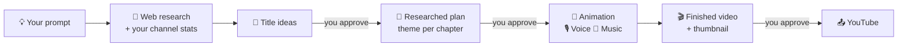

<div align="center">

# 🎬 AutoTube Studio

### Your own faceless YouTube video factory: research, script, animation, voice and upload, on your own computer.

**Built by Sanjeev ([@Skumarg20](https://github.com/Skumarg20)), IIT Kanpur · creator of *Elevate with Sanjeev***


</div>

---

## 📌 What is AutoTube Studio?

AutoTube Studio turns **one line of idea** into a **finished, animated, voiced YouTube video**, and keeps doing it every day for every channel you run.

You don't need a camera, a face, an editor or a designer. You tell the studio what your channel is about. It then:

1. 🔎 **Researches** trending and useful topics on the web, and learns from your own channel's best videos
2. ✍️ **Writes** the script and a chapter-by-chapter plan
3. 🎨 **Animates** every chapter in a hand-drawn look chosen for that content (55 looks)
4. 🎙️ **Narrates** with a natural voice: English, Hindi, Hinglish or your own cloned voice
5. 🎵 **Mixes** music and sound effects, adds captions and makes a thumbnail
6. 📤 **Uploads** to YouTube at the time you choose

**You stay in control.** Nothing goes out until you approve it: title → plan → video → upload.

---

## ✨ What you can do with it

| | Feature | What it means for you |
|---|---|---|
| 📺 | **Many channels, one studio** | Run history, education, facts, stories, ads and more from a single dashboard |
| 💡 | **Ideas from a prompt** | Type "kitchen myths that science disproves" and get researched title ideas, each marked Short or Long |
| 📈 | **Learns from your channel** | Reads your YouTube views and engagement and suggests more of what already works for you |
| 🗓️ | **Month planner** | Plan a full month (for example 4 Shorts a day). Change any title, day, time or theme from the calendar. Each video is researched and made fresh on its day |
| 🎨 | **55 animation themes** | Whiteboard, newsreel, map, comic, paper-cut, investigation board and many more, mixed per chapter by content |
| 🧮 | **Exam mode (JEE / NEET)** | Solved questions, formulas, quizzes with timers, simulations, and whiteboard working only where it's needed |
| 🎙️ | **Voices** | Free English voices built in; ElevenLabs for Hindi, Hinglish or your own cloned voice |
| ⏰ | **Autopilot schedule** | Set "ready by 7 am" and it starts the night before, so videos are waiting for you in the morning |
| ✅ | **Approval at every step** | Approve, edit, remake, reject or publish now, from the Videos page |
| 🖼️ | **Thumbnails and captions** | Thumbnail made for every video, captions burned in (optional) |
| 📤 | **Auto upload** | YouTube upload with title, description, tags and scheduled publish time (Instagram and Facebook uploaders included) |
| 🖥️ | **Server mode** | Run it 24×7 on a Windows server with a password-protected dashboard you can open from your phone |
| ⚡ | **Extra render PCs** | A second computer can help render videos faster |
| 💾 | **Safe by design** | Daily backups, auto clean-up of old work files, a health check page and a pre-flight "doctor" check |

---

## 🔄 How it works



Or let the **schedule** do it: the month planner fills every day with titles, and each one goes through the same steps on its day.

---

## 🖥️ What you need

| | Minimum | Recommended |
|---|---|---|
| **Windows** | 10 / 11 or Server 2019+ | Windows 11 / Server 2022 |
| **CPU / RAM** | 4 cores / 8 GB | 8+ cores / 16+ GB |
| **Disk** | 40 GB free | 150 GB+ (a long video uses about 1 GB while it is being made) |
| **AI account** | An Anthropic account (Pro or Max sign-in) **or** an Anthropic API key | |
| **Optional** | ElevenLabs key (Hindi / Hinglish / cloned voice), a Google account for YouTube upload | |

---

## 🚀 Setup (one time, about 30 minutes)

### Step 1: Get the code

```powershell
cd $HOME
git clone https://github.com/Skumarg20/AutoTube-Studio.git autotube-studio
```

### Step 2: Get the animation library

AutoTube Studio draws its videos with the **Lemo Opuscar** animation library (MIT licence, by LemoLab).
Put it in this folder:

```
%USERPROFILE%\lemo-opuscar-src\lemo-opuscar-main
```

(Or place `lemo-opuscar.zip` inside the `deploy` folder and the installer will unpack it for you.)

### Step 3: Run the installer

Open **PowerShell as Administrator** and run:

```powershell
cd $HOME\autotube-studio\deploy
powershell -ExecutionPolicy Bypass -File .\install.ps1
```

The installer does everything by itself:
- installs Node.js, Python 3.12, FFmpeg, Git and the Visual C++ runtime
- installs the render browser and the voice and music tools
- asks you to **sign in to your AI account once**
- runs a health check and opens the studio at **http://localhost:4747**

> 💡 Running it on a server? Use `.\install.ps1 -Server`. It adds a dashboard password, a free https link, auto-start with Windows and never-sleep power settings. See [DEPLOY.md](DEPLOY.md).

### Step 4: Start the studio any time

Double-click **AutoTube Studio** on your desktop (or `start.cmd`). Keep its window open while videos are being made.

### Step 5 (optional): Keys and settings

Copy `config\.env.example` to `config\.env` and fill in only what you need:

| Setting | What it does |
|---|---|
| `ANTHROPIC_API_KEY` | Leave empty to use your sign-in. Fill it to bill an API key instead |
| `ELEVENLABS_API_KEY` | Hindi / Hinglish / cloned voices (you can also add it in **Settings → Voice**) |
| `HS_TUNNEL` | `quick` = free public https link, `off` = this computer only |
| `PORT` | Dashboard port (default `4747`) |

🔒 **Never share `config\.env`, `config\settings.json` or anything in `channels\` and `data\`.** They hold your keys and logins, and `.gitignore` keeps them out of Git.

---

## 🎥 Make your first video (10 minutes of your time)

**1. Add a channel**
Go to **Channels → Add a channel** and fill in:
- **Name**, and **what the channel is about** (be specific: "JEE physics concepts explained with real-life examples")
- **Who watches**, **language** and **voice**
- **Channel type:** *Any topic*, *History documentaries* or *JEE / NEET preparation*
- How many **Shorts** and **long videos** a day, and the **publish times**

**2. Get ideas**
Open **Ideas** and type a prompt, for example:
> *"Physics behind everyday things that students never notice"*

The studio researches the web (and your channel's results) and suggests titles, each marked **Short** or **Long**.

**3. Approve a title → get the plan**
The plan shows every chapter, what is said, and **which animation theme** is used and why. Change anything you don't like.

**4. Approve the plan → the video is made**
Your computer animates, narrates, mixes and renders it. A Short takes minutes; a long video takes longer.

**5. Watch and approve**
Open **Videos**. Each video has a menu: **Approve**, **Publish now**, **Make again**, **Reject** or **Delete**.

**6. Upload**
Connect YouTube once in **Settings → Connections** (a free Google key, about 10 minutes). After that, approved videos go out at their publish time. Without it, just download the video from the Videos page.

🎉 **That's it. Your first faceless video is live.**

---

## 🗓️ Put a channel on autopilot

1. Open the channel and switch on **Run on schedule**.
2. Set **Ready by** (for example `07:00`) and how many hours early it should start.
3. Optional: open the **Calendar** and plan a whole month. Click any day to change its title, time or theme, or leave the theme on **Auto**.
4. Every morning, open **Videos** and approve what you like.

---

## 📁 Project structure

```
autotube-studio/
├── server.mjs          # The studio: dashboard, scheduler, video queue
├── worker.mjs          # Render helper for a second PC
├── dashboard/          # The web dashboard (Channels, Ideas, Calendar, Videos, Settings)
├── lib/                # Research, ideas, planning, voice, scheduling, YouTube stats
│   └── v2/             # Themes, director, timeline and build pipeline
├── engine/             # Drawing, exam boards, simulations, thumbnails, sound mix
├── uploaders/          # YouTube, Instagram, Facebook
├── studio-themes/      # Extra themes made for this studio
├── tools/              # Doctor check, voice tools, password tool, tests
├── deploy/             # Installer, server setup, auto-start, release builder
└── config/             # Example settings (your real keys stay local)
```

---

## 🛠️ Useful commands

| Task | Command |
|---|---|
| Start the studio | `start.cmd` or `node server.mjs` |
| Check the computer is ready | `node tools\doctor.mjs` |
| Set a dashboard password | `node tools\set-password.mjs` |
| Is it running? | open `http://localhost:4747/healthz` |
| Stop it | `deploy\stop-studio.ps1` |
| Build an installer for another PC | `deploy\make-release.ps1` |

---

## ❓ FAQ

**Do I need to show my face or record my voice?**
No. Everything is animated and narrated. You can clone your own voice if you want.

**Will it upload without asking me?**
No. By default every step waits for your approval.

**Can I run two studios for the same channel?**
No. Run one studio per set of channels, or every video is made and uploaded twice. Use **Settings → Workers** to add a second PC for rendering only.

**What if the AI usage limit is reached?**
The studio waits for the limit to reset and continues by itself.

---

## 🙏 Credits

- Animation themes: **Lemo Opuscar** library by LemoLab (MIT licence)
- Lip-sync: Rhubarb Lip Sync · Avatars: DiceBear Open Peeps · Fonts: Google Fonts (OFL)

---

<div align="center">

**Made with ❤️ by Sanjeev ([@Skumarg20](https://github.com/Skumarg20))**

*If this project helps you, give it a ⭐*

</div>
